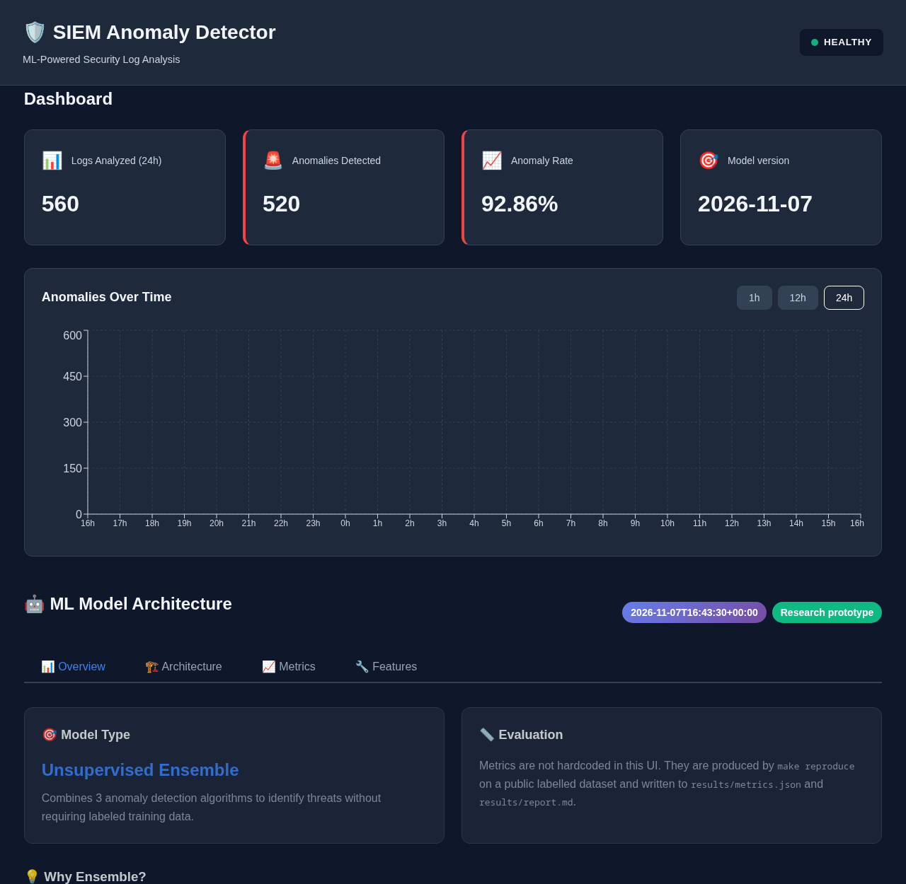
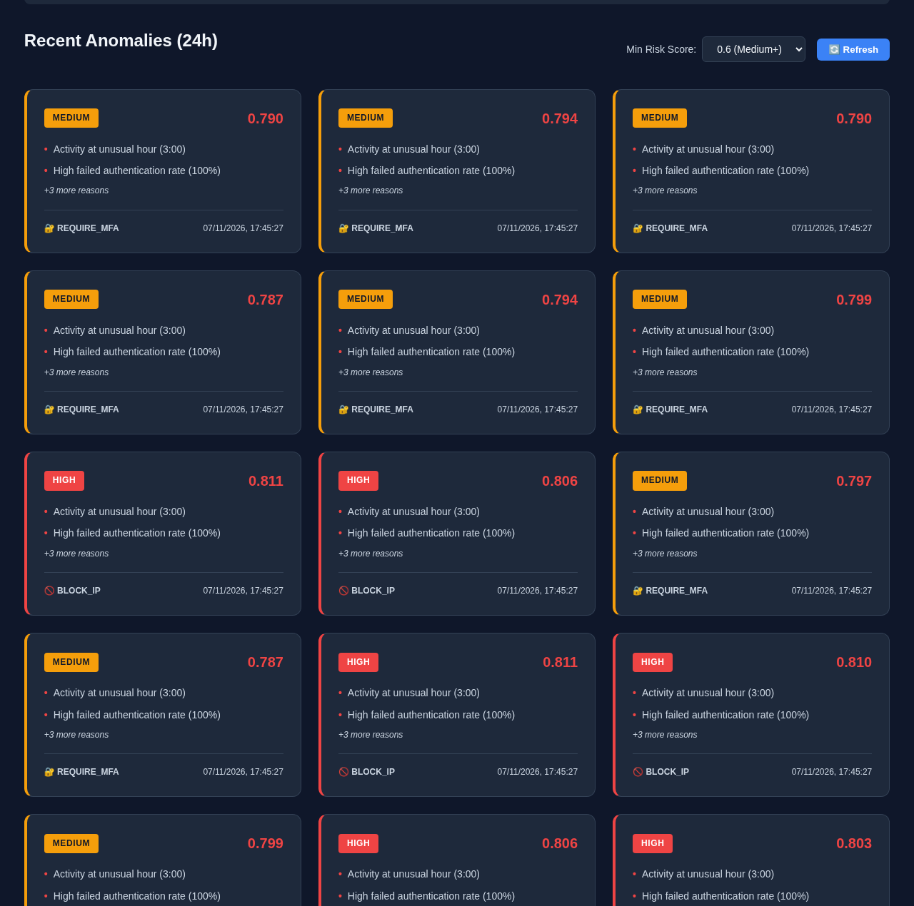

# SIEM Anomaly Detector

> **Research prototype / portfolio project. Not a product.** It is a small, reproducible study of
> unsupervised anomaly detection on web-server logs, wrapped in a FastAPI service and a React dashboard.
> It has not been run against production traffic and makes no claims about cost savings, false-positive
> reduction or competitiveness with commercial SIEMs.

## Headline finding

**On the same host, a one-line volumetric rule ("requests from the same IP in the last 60 s") matches the ML
(F1 0.999, FPR 0 %). But its threshold does not transfer to other hosts (FPR 55.7 % on benign mail/cloud
traffic), while Isolation Forest stays at 0.02 %. The measured value of the ML is in transfer across hosts and
in low-volume attacks (recall 0.78 [0.57, 0.91]).**

Caveats that go with those figures: the mail/cloud lines are unlabelled and benign only *by convention* of the
dataset (labels exist only for files containing attacks); that cross-host evaluation was *added after the first
test run* (it adds a measurement, it changes no threshold or protocol); the low-volume subset is 19 lines, so the
interval is wide; and it is one scenario on one dataset. Isolation Forest's low cross-host FPR shows it is not
fooled by those hosts' bursts, not that it is production-ready.

Recommended detection from this study: **rule OR Isolation Forest** (`combined_rule_or_isolation_forest`) with
thresholds fitted per host; reusing the rule's threshold across hosts is not advisable.

## What it does

- Parses Apache/Nginx access logs, syslog, `auth.log` and iptables lines (`backend/parsers`).
- Computes 21 deterministic, causal sliding-window features per event (`backend/ml/features.py`).
- Scores events with an unsupervised Isolation Forest (`backend/ml/ensemble.py`). DBSCAN and GMM remain as
  opt-in components with weight 0 by default (see below).
- Serves scores through a FastAPI API, stores anomalies in PostgreSQL, shows them in a React dashboard.
- Evaluates everything on a public labelled dataset with a leak-free temporal protocol (`backend/eval`).

Out of scope: deep learning, cloud deployment, alert delivery (Slack/e-mail/PagerDuty settings exist in
`config.py` but are not implemented), authentication on the API, multi-worker operation.

## Results

Reproduce with one command (downloads ~1 MB, trains, evaluates, benchmarks, refreshes this table):

```bash
make install && make reproduce
```

Every number in this section is generated from `results/metrics.json` and `results/benchmark.json`
by `scripts/update_readme.py`; a test fails if the block is stale. The full report with all models,
ablations and per-attack-type recall is in [`results/report.md`](results/report.md).

<!-- RESULTS:START (generated by scripts/update_readme.py from results/*.json; do not edit) -->

Dataset: AIT-LDSv2 `russellmitchell`, Apache access log of `intranet_server` (CC-BY-NC-SA-4.0). Train 2014 / validation 817 / test 8299 lines; the test period contains 7695 attack lines (prevalence 0.927), so precision and PR-AUC are inflated by the base rate (a random scorer has PR-AUC = 0.927; base rate is 0 in train and validation by construction). "FPR (other hosts)" is the alert rate on 15003 unlabelled, benign-by-convention test-day lines from two other web vhosts. Threshold: 99% quantile of benign validation scores. Mean ± std over 5 seeds; the rule baseline is deterministic.

**Variant `all_features`** (pre-registered, held-out)

| Model | Precision | Recall | F1 | PR-AUC | FPR (test benign) | FPR (other hosts) | Recall on low-rate attacks [Wilson 95%] |
|---|---|---|---|---|---|---|---|
| rule_requests_per_60s | 1.000 ± 0.000 | 0.998 ± 0.000 | 0.999 ± 0.000 | 1.000 ± 0.000 | 0.000 ± 0.000 | 0.5572 (n=15003) | 0.000 [0.00, 0.17] (n=19) |
| isolation_forest | 0.999 ± 0.000 | 0.999 ± 0.001 | 0.999 ± 0.000 | 1.000 ± 0.000 | 0.016 ± 0.006 | 0.0002 (n=15003) | 0.779 [0.57, 0.91] (n=19) |
| combined_rule_or_isolation_forest | 0.999 ± 0.000 | 0.999 ± 0.000 | 0.999 ± 0.000 | 1.000 ± 0.000 | 0.016 ± 0.006 | 0.5572 (n=15003) | 0.768 [0.57, 0.91] (n=19) |

**Variant `no_calendar_features`** (post-hoc, in-sample design decision)

| Model | Precision | Recall | F1 | PR-AUC | FPR (test benign) | FPR (other hosts) | Recall on low-rate attacks [Wilson 95%] |
|---|---|---|---|---|---|---|---|
| rule_requests_per_60s | 1.000 ± 0.000 | 0.998 ± 0.000 | 0.999 ± 0.000 | 1.000 ± 0.000 | 0.000 ± 0.000 | 0.5572 (n=15003) | 0.000 [0.00, 0.17] (n=19) |
| isolation_forest | 0.999 ± 0.000 | 1.000 ± 0.000 | 0.999 ± 0.000 | 1.000 ± 0.000 | 0.016 ± 0.004 | 0.0001 (n=15003) | 0.905 [0.69, 0.97] (n=19) |
| combined_rule_or_isolation_forest | 0.999 ± 0.000 | 1.000 ± 0.000 | 0.999 ± 0.000 | 1.000 ± 0.000 | 0.015 ± 0.004 | 0.5573 (n=15003) | 0.905 [0.69, 0.97] (n=19) |

Throughput (`make benchmark`, Intel(R) Core(TM) Ultra 9 185H, Python 3.12.13, single process, parse + features + score only; no HTTP or database): 169 events/s, latency p50 5.2 ms / p95 9.4 ms.

<!-- RESULTS:END -->

### How to read these numbers

- **The task is easy.** The test period is dominated by two volumetric scanners (dirb, wpscan). Do not read the
  high F1 as evidence of a strong detector. Base rate in train and validation is 0 by construction and 0.927 in
  test, so precision and PR-AUC are inflated; the more informative columns are FPR, recall per attack type and the
  low-rate subset.
- **"FPR (other hosts)" is a cross-host transfer test, not a same-host false-alarm rate.** It scores the benign
  test-day traffic of two other web vhosts with models and thresholds learned on `intranet_server`. The volume
  rule fires on more than half of those lines (a busy page load is a burst of requests) while Isolation Forest
  stays near zero. That shows the rule's threshold is host-specific; it does not show Isolation Forest is
  production-ready. Those logs are unlabelled and benign only by the dataset's convention (labels exist only for
  files with attack lines).
- **Low-rate attacks: 19 lines.** The Wilson interval is wide. Per-type recall for `webshell_upload` (3 lines),
  `escalate` (4) and `service_scan` (12) is anecdotal.
- **The original "ensemble" was effectively Isolation Forest.** DBSCAN and GMM saturate to a constant score on
  the pre-registered variant (rows `component_*_only` and `ensemble_legacy_*`), because their score normalisers
  are hard-coded and because `day_of_week`/`is_weekend` fall outside the support of a 2-day training window.
  Dropping those two features (post-hoc variant) lets the GMM contribute, but it then fires on most other-host
  benign lines. **Decision: DBSCAN and GMM are retired from the default configuration** (weight 0: not trained, not
  scored). They remain in code behind `ENSEMBLE_WEIGHTS` for experiments; the evidence for keeping them is nil.
- **`no_calendar_features` is post-hoc.** It was added after inspecting the first run, and is reported, labelled
  as in-sample with respect to that design decision, next to the pre-registered `all_features` variant.
- One dataset, one scenario, one host, one attack campaign. Nothing here generalises to other environments.

### Evaluation protocol

| Item | Choice |
|---|---|
| Dataset | [AIT Log Data Set V2.0](https://doi.org/10.5281/zenodo.5789064) (Landauer et al.), scenario `russellmitchell`, `intranet_server` Apache access log. License CC BY-NC-SA 4.0 (non-commercial); data are downloaded, never committed. |
| Labels | Per-line attack labels shipped with the dataset (lines not listed are benign). |
| Split | By UTC calendar day, fixed in advance: train 21-22 Jan 2022, validation 23 Jan (benign), test from 24 Jan (attack campaign). A guard aborts if any attack line falls in train/validation. |
| Training | Unsupervised; labels are never used for fitting. |
| Threshold | 99% quantile of each model's scores on benign validation data. The test set plays no role. |
| Test use | Scored once per model and seed; seeds 0-4 declared up front. |
| Baselines | Rule (requests per IP in 60 s) and Isolation Forest alone, same split and same threshold rule. Also reported: rule OR Isolation Forest, the legacy 0.5/0.3/0.2 ensemble and each component alone. |
| Other hosts | Benign test-day lines of the `mail` and `cloud` vhosts of `webserver` (unlabelled, benign by dataset convention), scored without retraining, to estimate false alarms on more benign volume. They come from different hosts, so this is a distribution-shift test. |
| Test integrity | The other-host evaluation, the combined detector and the Wilson intervals were added after the first test run; they add measurements and do not change the headline protocol or thresholds. |
| Integrity | `datasets/*.manifest.json` pins SHA-256 of every downloaded file. |
| Unparsed lines | Lines the parser cannot read (e.g. HTTP 408 with request `"-"`) are skipped and counted in `metrics.json`. |

## Quick start

```bash
./scripts/init_env.sh          # creates .env with random secrets (compose refuses to start without them)
docker compose up --build      # API :8000, UI :5173, Grafana :3000 (all bound to 127.0.0.1)
```

On first start the API container trains a **synthetic demo model** if none exists (clearly logged and labelled
in the model metadata). To serve the evaluated model instead, run `make reproduce` and copy
`models/ensemble_*.joblib` into the `models_data` volume, or run the API locally with `MODEL_PATH=./models`.

```bash
curl -s -X POST localhost:8000/api/v1/logs/analyze -H 'content-type: application/json' \
  -d '{"log_line":"10.0.0.5 - - [24/Jan/2022:03:57:01 +0000] \"POST /sdk HTTP/1.1\" 404 360 \"-\" \"Nmap Scripting Engine\"","source":"nginx"}'
```

Without a loaded model the analysis endpoints return `503`; `/stats` and `/stats/timeseries` return `503`
when the database is unreachable (they never invent numbers). `/health` runs real probes against
PostgreSQL, Redis and the model.

## Architecture

```
log line -> parser -> FeatureEngineer (in-process sliding windows) -> ensemble scoring -> API
                                                                       |-> PostgreSQL (anomalies, logs)
                                                                       '-> Prometheus metrics / Grafana
React dashboard <---- /api/v1/{stats,anomalies,stats/timeseries}
```

More detail: [`docs/ARCHITECTURE.md`](docs/ARCHITECTURE.md), [`docs/ML_ARCHITECTURE.md`](docs/ML_ARCHITECTURE.md),
[`docs/LOG_INGESTION.md`](docs/LOG_INGESTION.md).




The screenshots show the dashboard after replaying part of the test period through the API with the evaluated
model. The risk levels (medium/high) come from fixed heuristic cut-offs (0.4/0.6/0.8), which are **not**
calibrated; the evaluation above uses thresholds fixed on validation data instead.

## Development

```bash
make test        # pytest + coverage gate (70%)
make lint        # ruff check + ruff format --check
make benchmark   # throughput (hardware recorded in results/benchmark.json)
make frontend-build
```

CI (`.github/workflows/ci.yml`): ruff, pytest with coverage, frontend build, `docker build` (no push).
Actions are pinned by SHA and the workflow has read-only permissions.

## Limitations

- Features are computed in-process: state is lost on restart and **more than one API worker would each see a
  partial window**. A shared (Redis-backed) aggregator is needed before scaling out.
- The alert levels (0.4/0.6/0.8) and the sigmoid normalisers in `backend/ml/scoring.py` are heuristics. Retraining on new data requires re-fixing a threshold on benign validation data.
- The `is_known_ip` feature is constant in training under this protocol (all training IPs are "known"), so the
  unsupervised models cannot learn from it.
- Syslog timestamps carry no year; the parser assumes the current year. Unparseable lines fall back to the
  ingestion time, which a hostile source can exploit (see below).
- `joblib` model files are pickles: only load models you trained yourself.
- No API authentication, rate limiting or audit trail. Do not expose it beyond localhost.
- Database tables are created at start-up only when `DEBUG=true`; no migrations are shipped.
- Dataset is CC BY-NC-SA 4.0: results here are for research/portfolio use.

## Adversarial risks of the detector itself

1. **Poisoning the baseline.** Models are fitted on "benign" traffic. An attacker active during the training
   window teaches the model that their behaviour is normal. Mitigation: train on audited periods, keep a
   held-out check, version and diff model files. Not implemented here.
2. **Mimicry / low-and-slow evasion.** Detection leans on per-IP request volume (the rule baseline matches the
   ML). An attacker who stays under the per-minute rate, rotates source IPs or imitates browser requests is
   largely invisible to these features. The 19 low-rate attack lines are the only evidence of non-volumetric
   detection and are too few to claim robustness.
3. **Log injection against parsers.** Attacker-controlled fields (URL, user agent, usernames) are parsed by
   regexes and logged. Crafted lines can break parsing (falling back to ingestion time and skewing the time
   windows), forge timestamps to flush windows, or spray source addresses (memory is bounded by
   `MAX_TRACKED_IPS`/`MAX_EVENTS_PER_IP`, but accuracy still degrades). Treat parsed fields as untrusted data.

## Repository layout

```
backend/        FastAPI app, parsers, features, ensemble, evaluation (backend/eval)
frontend/       React + Vite dashboard
scripts/        demo-model trainer, synthetic log generator (DEMO ONLY), benchmark, README updater
datasets/       SHA-256 manifest of the evaluation data (data itself is never committed)
results/        metrics.json, report.md, benchmark.json (generated)
tests/          pytest suite (fixtures contain a few real dataset lines, see tests/fixtures/README.md)
```

`scripts/log_generator.py` produces invented traffic for UI demos only and is not used for any reported metric.

## License

MIT for the code (see `LICENSE`). The evaluation dataset has its own license (CC BY-NC-SA 4.0).
