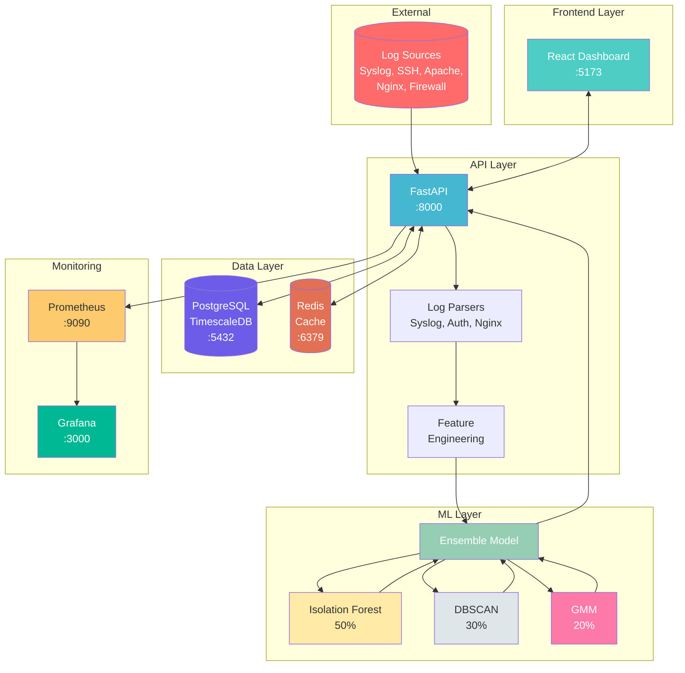
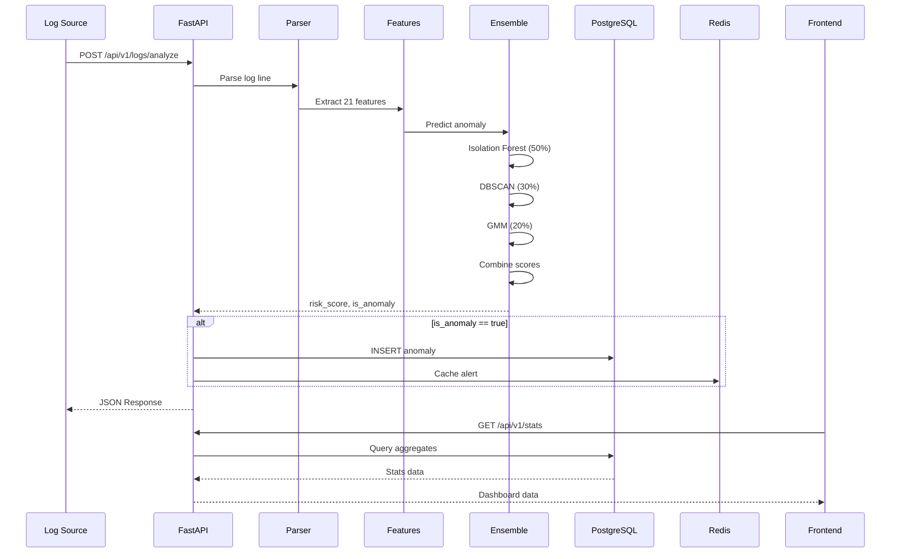
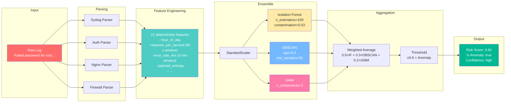
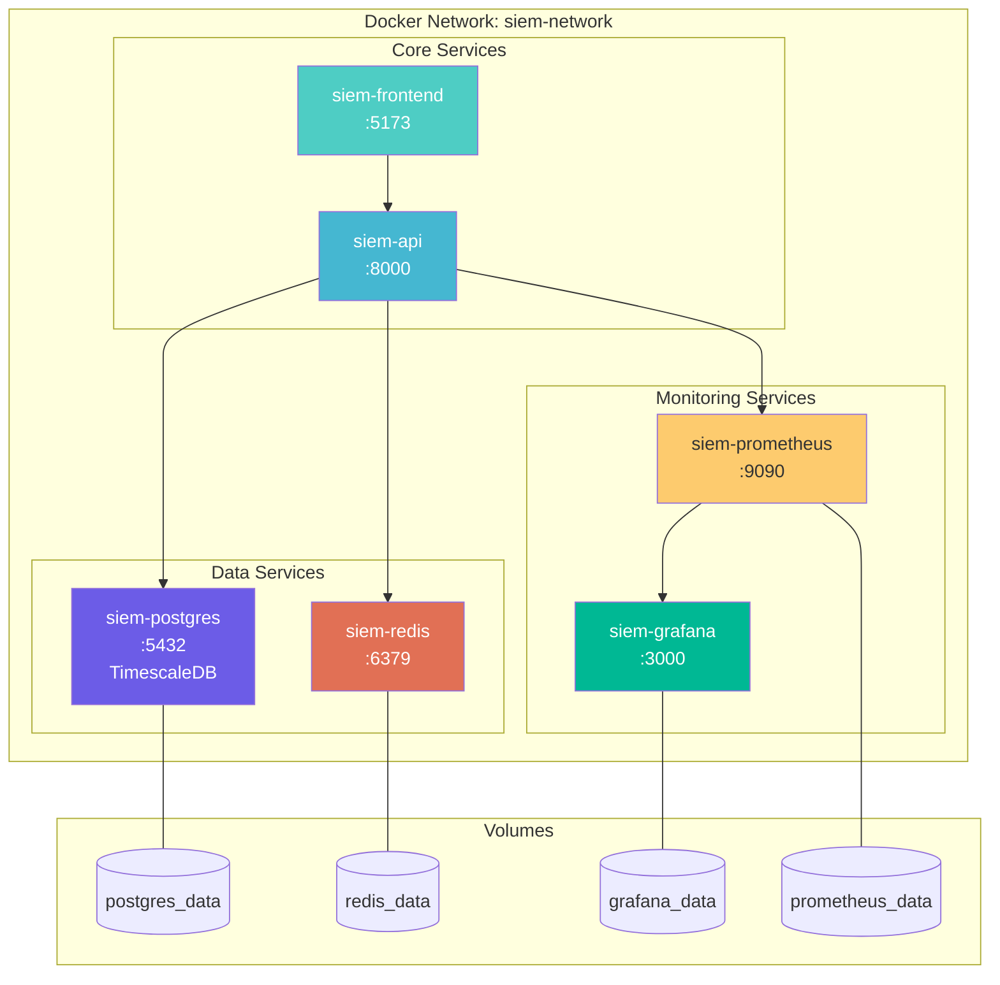
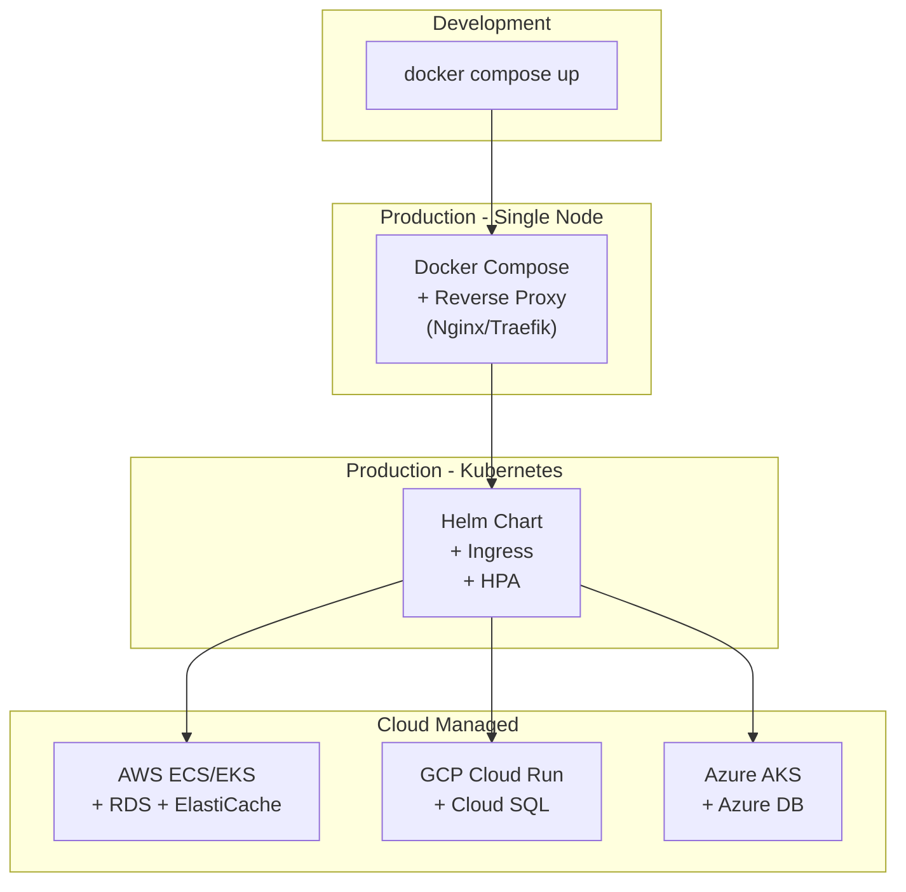

# SIEM Anomaly Detector - Architecture

> Note: diagrams below show the original three-model ensemble. Since the evaluation, the default configuration scores with Isolation Forest only (weights `1.0,0.0,0.0`); DBSCAN and GMM are opt-in. See ML_ARCHITECTURE.md.

## System Overview

```
                                    SIEM ANOMALY DETECTOR
    ============================================================================
    
                                   +------------------+
                                   |   Log Sources    |
                                   +------------------+
                                   | - Syslog         |
                                   | - Auth (SSH)     |
                                   | - Apache/Nginx   |
                                   | - Firewall       |
                                   | - Custom         |
                                   +--------+---------+
                                            |
                                            v
    +------------------+           +------------------+           +------------------+
    |     Frontend     |           |      API         |           |    Monitoring    |
    +------------------+   REST    +------------------+           +------------------+
    | React + TS       |<--------->| FastAPI          |           | Prometheus :9090 |
    | Vite             |   :8000   | Async/Await      |---------->| Grafana    :3000 |
    | Dashboard        |           | Structlog        |  metrics  |                  |
    | Recharts         |           +--------+---------+           +------------------+
    | :5173            |                    |
    +------------------+                    |
                                            v
                              +---------------------------+
                              |      ML Ensemble          |
                              +---------------------------+
                              |                           |
                              |  +---------------------+  |
                              |  | Isolation Forest    |  |
                              |  | (50% weight)        |  |
                              |  +---------------------+  |
                              |            +              |
                              |  +---------------------+  |
                              |  | DBSCAN              |  |
                              |  | (30% weight)        |  |
                              |  +---------------------+  |
                              |            +              |
                              |  +---------------------+  |
                              |  | GMM                 |  |
                              |  | (20% weight)        |  |
                              |  +---------------------+  |
                              |            |              |
                              |            v              |
                              |    Final Risk Score       |
                              |    (0.0 - 1.0)            |
                              +-------------+-------------+
                                            |
                              +-------------+-------------+
                              |                           |
                              v                           v
                    +------------------+       +------------------+
                    |   PostgreSQL     |       |      Redis       |
                    +------------------+       +------------------+
                    | TimescaleDB      |       | Cache            |
                    | Anomalies Table  |       | Rate Limiting    |
                    | Logs Table       |       | Session Data     |
                    | Alerts Table     |       | :6379            |
                    | :5432            |       +------------------+
                    +------------------+
```

---

## Component Diagram (Mermaid)



---

## Data Flow Diagram



---

## ML Ensemble Architecture



---

## Docker Services Architecture



---

## Feature Categories

The authoritative list is `FEATURE_NAMES` in `backend/ml/features.py`. All features are deterministic and
causal (an event only sees itself and earlier events); per-IP windows are held in memory.

| Group | Features |
|---|---|
| Temporal (4) | hour_of_day, day_of_week, is_weekend, is_business_hours |
| Per-IP activity (4) | login_attempts_per_minute, requests_per_second (60 s), unique_ips_last_hour, unique_endpoints_accessed (5 min) |
| Per-IP ratios, 5 min (3) | failed_auth_rate, error_rate_4xx, error_rate_5xx |
| Event content (7) | status_class, is_known_ip, bytes_transferred, time_since_last_activity_sec, path_length, special_char_ratio, payload_entropy |
| Context (3) | is_privileged_user, is_sensitive_endpoint, is_known_user_agent |

Earlier versions also had geographic distance, country and session-duration features; they were filled with
random numbers (no GeoIP or session tracking existed) and have been removed.

---

## Ports Reference

| Service | Port | Protocol | Description |
|---------|------|----------|-------------|
| Frontend | 5173 | HTTP | React Dashboard |
| API | 8000 | HTTP | FastAPI REST API |
| PostgreSQL | (internal) | TCP | TimescaleDB; not published to the host |
| Redis | (internal) | TCP | Connectivity probe only; not published to the host |
| Prometheus | 9090 | HTTP | Metrics Collection |
| Grafana | 3000 | HTTP | Monitoring Dashboards |

---

## Technology Stack

```
+------------------+------------------+------------------+
|     FRONTEND     |     BACKEND      |   INFRASTRUCTURE |
+------------------+------------------+------------------+
| React 18         | Python 3.10+     | Docker           |
| TypeScript       | FastAPI          | Docker Compose   |
| Vite             | SQLAlchemy       | PostgreSQL 15    |
| Recharts         | AsyncPG          | TimescaleDB      |
| CSS3             | Pydantic v2      | Redis            |
|                  | Structlog        | Prometheus       |
|                  | scikit-learn     | Grafana          |
|                  | NumPy/Pandas     |                  |
+------------------+------------------+------------------+
```

---

## Security Boundaries

```
    EXTERNAL                    DMZ                         INTERNAL
    ========                    ===                         ========
    
    +--------+            +------------+              +---------------+
    | Logs   |  --------> | API :8000  | -----------> | PostgreSQL    |
    | (Any   |    REST    | (Validates |    SQL       | (Encrypted)   |
    | Source)|            |  & Parses) |              +---------------+
    +--------+            +------------+                     ^
                                |                            |
    +--------+            +------------+              +---------------+
    | Users  |  --------> | Frontend   | -----------> | Redis         |
    | (SOC   |   HTTPS    | :5173      |   Cache      | (Auth)        |
    | Analyst|            | (Auth*)    |              +---------------+
    +--------+            +------------+
    
    * Authentication: TODO (JWT planned)
```

---

## Deployment Options



---

## File Structure

```
SIEM-Anomaly-Detector-ML/
├── backend/
│   ├── api/routes/          # REST endpoints
│   ├── db/                  # Database models & CRUD
│   ├── ml/                  # ensemble, features, scoring
│   ├── eval/                # dataset fetch, protocol, metrics
│   ├── parsers/             # Log parsers
│   ├── main.py              # FastAPI app
│   └── config.py            # Settings
├── frontend/
│   ├── src/
│   │   ├── components/      # React components
│   │   ├── services/        # API client
│   │   └── App.tsx          # Main app
│   └── vite.config.ts
├── docs/
│   ├── ARCHITECTURE.md      # This file
│   └── ML_ARCHITECTURE.md   # ML details
├── scripts/
│   ├── train_demo_model.py  # synthetic DEMO model for the container
│   ├── benchmark.py         # throughput measurement
│   └── log_generator.py     # DEMO ONLY synthetic traffic
├── tests/                   # pytest suite
├── results/                 # generated evaluation artefacts
├── monitoring/
│   ├── prometheus.yml
│   └── grafana/
├── docker-compose.yml       # Full stack
└── README.md
```

---

*Updated 2026-11-07 to match the code; diagrams above that mention eps=5.0 are illustrative, defaults are in `.env.example`.*
